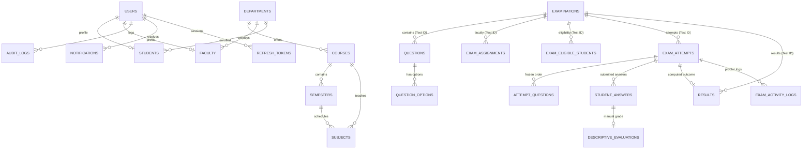

# ExaNova – Database Schema Documentation

**Application:** ExaNova – Smart College Examination & Assessment System  
**Tagline:** Smart Examination for a Smarter Future.  
**Developer:** Durjodhan Mondal ([info@ticollege.ac.in](mailto:info@ticollege.ac.in))  
**Organization:** Techno Main Salt Lake, Kolkata, India  
**Database Engine:** PostgreSQL 15+ / Neon Serverless PostgreSQL  
**ORM:** TypeORM with strict migration discipline (`synchronize: false`)

---

## 1. Architectural Philosophy: The Authoritative Test UUID

Every examination created in ExaNova receives a unique PostgreSQL UUID v4 (`test_id`). This UUID is the single source of truth and authoritative foreign key linking all examination-related subsystems:
- Examination metadata (`examinations.id`)
- Faculty creator and invigilator assignments (`exam_assignments.test_id`)
- Student eligibility access lists (`exam_eligible_students.test_id`)
- Question bank and exam questions (`questions.test_id`)
- In-memory staged imports (`question_imports.test_id`)
- Student exam attempts (`exam_attempts.test_id`)
- Student submitted answers (`student_answers.test_id`)
- Descriptive evaluation queue (`descriptive_evaluations.test_id`)
- Calculated results and scorecards (`results.test_id`)
- Result release declarations (`result_releases.test_id`)
- Proctoring & anti-cheating logs (`exam_activity_logs.test_id`)

---

## 2. Entity Relationship Diagram (Mermaid)

---

## 3. Database Tables Reference (31 Tables)

### Authentication & Users
1. **`users`**: Central credentials table storing `id (UUID)`, `username`, `email`, `password_hash (Argon2id)`, `role (ADMIN, FACULTY, STUDENT)`, `status (ACTIVE, INACTIVE, SUSPENDED)`, and `must_change_password`.
2. **`refresh_tokens`**: Stores hashed refresh tokens with family UUID tracking for token-rotation security and multi-device revocation.
3. **`password_reset_tokens`**: One-time cryptographic tokens with expiration timestamps for password recovery.

### Academic Structure
4. **`departments`**: Academic departments (`name`, `code` unique e.g., 'CSE', `description`, `is_active`). Protected against deletion if active courses, faculty, or examinations exist.
5. **`courses`**: Academic programs (`name`, `code` e.g., 'BTECH-CSE', `duration_years`, `total_semesters`, `department_id`). Auto-seeds semesters 1 to N upon creation.
6. **`semesters`**: Course semesters (`course_id`, `semester_number`, `name`). Unique on `(course_id, semester_number)`.
7. **`subjects`**: Courses taught per semester (`name`, `code` e.g., 'CS301', `credits`, `course_id`, `semester_id`).
8. **`academic_sessions`**: College academic years (`name` e.g., '2025-2026', `start_date`, `end_date`, `is_current`). Enforces a single active session at any given time.

### Profiles
9. **`faculty`**: Faculty profile (`user_id`, `employee_id` unique, `designation`, `department_id`, `phone`).
10. **`faculty_subject_assignments`**: Maps faculty members to subjects taught (`faculty_id`, `subject_id`, `academic_session_id`).
11. **`students`**: Student profile (`user_id`, `roll_number` unique, `registration_number` unique, `first_name`, `last_name`, `department_id`, `course_id`, `current_semester_id`, `academic_session_id`).

### Question Bank & Reusability
12. **`question_banks`**: Reusable question repository by subject (`name`, `subject_id`, `created_by_faculty_id`, `description`).
13. **`question_bank_items`**: Questions stored in banks (`question_bank_id`, `question_text`, `question_type`, `marks`, `negative_marks`, `topic`, `difficulty`, `expected_answer`, `options_json`).

### Examination Core
14. **`examinations`**: Examination master table indexed by authoritative `id (UUID)`. Contains `title`, `examination_code` (unique), `description`, `department_id`, `course_id`, `semester_id`, `subject_id`, `academic_session_id`, `created_by_faculty_id`, `examination_type (MCQ, DESCRIPTIVE, MIXED)`, `status (DRAFT, SCHEDULED, PUBLISHED, LIVE, COMPLETED, CANCELLED)`, `start_window`, `end_window`, `duration_minutes`, `total_marks`, `passing_marks`, `max_attempts`, `randomize_questions`, `randomize_options`, `negative_marking_type (NONE, FIXED, FRACTION, CUSTOM)`, `negative_marking_value`, `allow_negative_marks_below_zero`, `instructions`, and `result_visibility`.
15. **`exam_assignments`**: Faculty assignment to exam (`test_id`, `faculty_id`, `role: CREATOR | INVIGILATOR | EVALUATOR`).
16. **`exam_eligible_students`**: Whitelist of students permitted to take the examination (`test_id`, `student_id`, `is_eligible`).

### Questions & Options
17. **`questions`**: Individual examination questions (`id (UUID)`, `test_id (UUID)`, `question_text`, `question_type (MCQ, DESCRIPTIVE)`, `marks`, `negative_marks`, `topic`, `difficulty (EASY, MEDIUM, HARD)`, `question_order`, `answer_instructions`, `evaluation_criteria`, `expected_answer`).
18. **`question_options`**: Options for MCQ questions (`id (UUID)`, `question_id (UUID)`, `option_label (A, B, C, D)`, `option_text`, `is_correct (boolean)`, `option_order`).

### Zero-Storage Staged Imports
19. **`question_imports`**: In-memory upload batch tracker (`id (UUID)`, `test_id (UUID)`, `uploaded_by_faculty_id`, `filename`, `file_format (DOCX, XLSX)`, `total_questions`, `valid_questions`, `invalid_questions`, `status (PENDING, VALIDATED, CONFIRMED, REJECTED, CANCELLED)`). Original files are never written to disk or database.
20. **`question_import_items`**: Staged parsed questions awaiting faculty review/edit (`import_id`, `question_number`, `question_type`, `question_text`, `marks`, `negative_marks`, `options_json`, `correct_answer`, `is_valid`, `validation_errors`).
21. **`question_import_errors`**: Detailed validation errors for staged questions (`import_id`, `row_number`, `field_name`, `error_message`, `error_code`).

### Exam Attempts & Responses
22. **`exam_attempts`**: Student exam sessions (`id (UUID)`, `test_id (UUID)`, `student_id (UUID)`, `attempt_number`, `started_at`, `expires_at`, `submitted_at`, `status (IN_PROGRESS, SUBMITTED, EVALUATED, EXPIRED, CANCELLED)`, `ip_address`, `user_agent`, `remaining_seconds`).
23. **`attempt_questions`**: Server-frozen question and option presentation sequence (`attempt_id`, `question_id`, `display_order`, `shuffled_option_ids (UUID array)`, `status: NOT_VISITED | UNANSWERED | ANSWERED | MARKED_FOR_REVIEW | ANSWERED_AND_MARKED_FOR_REVIEW`).
24. **`student_answers`**: Student answers submitted during or at the end of the test (`attempt_id`, `test_id`, `question_id`, `selected_option_id`, `descriptive_answer_text`, `is_answered`, `is_correct`, `marksAwarded`, `negativeMarksDeducted`, `evaluatedAt`).

### Evaluations & Results
25. **`descriptive_evaluations`**: Evaluation queue for manual grading of descriptive responses (`id (UUID)`, `test_id (UUID)`, `student_answer_id (UUID)`, `assigned_faculty_id`, `maximum_marks`, `marks_awarded`, `feedback`, `status (PENDING, IN_PROGRESS, COMPLETED)`, `evaluated_at`).
26. **`evaluation_feedbacks`**: Detailed feedback from faculty to student (`attempt_id`, `faculty_id`, `student_id`, `feedback_text`).
27. **`results`**: Final calculated grades (`id (UUID)`, `test_id (UUID)`, `student_id (UUID)`, `attempt_id (UUID)`, `total_questions`, `correct_answers`, `incorrect_answers`, `unanswered_count`, `mcq_marks_awarded`, `negative_marks_deducted`, `net_mcq_score`, `descriptive_score`, `final_marks`, `maximum_marks`, `percentage`, `grade`, `pass_fail_status (PASS, FAIL)`, `status (CALCULATED, PUBLISHED, WITHHELD)`, `rank`, `calculated_at`, `released_at`).
28. **`result_releases`**: Official publication event records (`test_id`, `released_by_user_id`, `released_at`, `remarks`).

### Monitoring & Notifications
29. **`notifications`**: User alert dispatch (`user_id`, `type`, `title`, `message`, `metadata`, `is_read`).
30. **`audit_logs`**: System security and administrative event ledger (`user_id`, `action`, `entity_type`, `entity_id`, `details (JSONB)`, `ip_address`, `user_agent`).
31. **`exam_activity_logs`**: Real-time examination telemetry (tab focus/blur, window resize, answer auto-save events with timestamps).

---

## 4. Key PostgreSQL Indexes & Constraints
- Unique index on `students(roll_number)` and `students(registration_number)`.
- Unique composite index on `semesters(course_id, semester_number)`.
- Unique composite index on `results(test_id, student_id, attempt_id)`.
- Foreign key cascading on child attempt and question records; `ON DELETE RESTRICT` on departments and courses referenced by active exams.
- High-performance B-tree indexes on `(test_id)`, `(student_id)`, `(attempt_id)`, and `(user_id)` across all operational tables.
